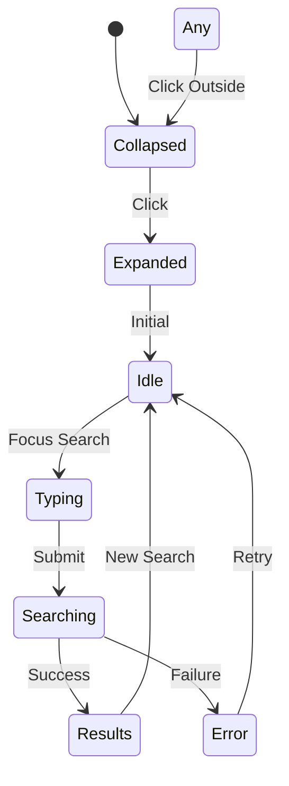
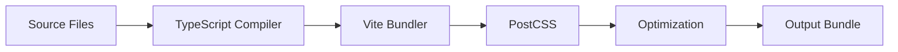

# 🏗️ Architecture Guide - React Widget Library

## Overview
This document details the technical architecture, design patterns, and system design of the React Widget Library.

## Table of Contents
- [Architecture Philosophy](#architecture-philosophy)
- [Atomic Design Implementation](#atomic-design-implementation)
- [State Management Architecture](#state-management-architecture)
- [Component Communication](#component-communication)
- [Design System](#design-system)
- [Performance Architecture](#performance-architecture)
- [Build Architecture](#build-architecture)
- [Testing Architecture](#testing-architecture)

---

## Architecture Philosophy

### Core Principles

1. **Separation of Concerns**
   - UI components are pure and stateless
   - Business logic lives in templates/containers
   - Styling through design tokens
   - Clear data flow patterns

2. **Composability**
   - Small, reusable components
   - Components compose into larger structures
   - Props-based configuration
   - Minimal dependencies

3. **Type Safety**
   - Full TypeScript coverage
   - Strict type checking
   - Interface-driven development
   - Runtime validation where needed

4. **Performance First**
   - Lazy loading components
   - Optimized re-renders
   - Efficient state updates
   - Bundle size optimization

---

## Atomic Design Implementation

### Architecture Layers

```
┌─────────────────────────────────────┐
│           TEMPLATES                  │ ← State Management
├─────────────────────────────────────┤
│           ORGANISMS                  │ ← Complex UI Logic
├─────────────────────────────────────┤
│           MOLECULES                  │ ← Compound Components
├─────────────────────────────────────┤
│             ATOMS                    │ ← Basic Building Blocks
└─────────────────────────────────────┘
```

### Layer Responsibilities

#### Atoms (Foundation Layer)
```typescript
// Pure, stateless, single-purpose
interface AtomProps {
  className?: string;
  style?: CSSProperties;
  children?: ReactNode;
}

// Example: Icon atom
const Icon: FC<AtomProps> = ({ className }) => (
  <svg className={className}>...</svg>
);
```

**Characteristics**:
- No business logic
- No state management
- Pure presentation
- Maximum reusability

#### Molecules (Composition Layer)
```typescript
// Combines atoms with minimal logic
interface MoleculeProps extends AtomProps {
  onClick?: () => void;
  value?: string;
}

// Example: SearchBar molecule
const SearchBar: FC<MoleculeProps> = ({ value, onChange }) => (
  <div className="search-container">
    <SearchIcon />
    <input value={value} onChange={onChange} />
    <MicIcon />
  </div>
);
```

**Characteristics**:
- Combines 2-3 atoms
- Handles basic events
- Minimal local state
- Clear single purpose

#### Organisms (Feature Layer)
```typescript
// Complex sections with business logic
interface OrganismProps {
  data: ComplexData;
  onAction: (action: Action) => void;
}

// Example: TypingPhase organism
const TypingPhase: FC<OrganismProps> = ({ searchValue, suggestions }) => (
  <GlassContainer>
    <Header />
    <SearchBar value={searchValue} />
    <AutocompleteDropdown suggestions={suggestions} />
    <Footer />
  </GlassContainer>
);
```

**Characteristics**:
- Combines multiple molecules
- Implements features
- Coordinates components
- Handles complex interactions

#### Templates (Application Layer)
```typescript
// Full layouts with state management
const MainFlow: FC = () => {
  const [state, dispatch] = useReducer(widgetReducer, initialState);

  return (
    <WidgetContext.Provider value={{ state, dispatch }}>
      {renderPhaseComponent(state.phase)}
    </WidgetContext.Provider>
  );
};
```

**Characteristics**:
- Manages application state
- Orchestrates data flow
- Handles side effects
- Controls phase transitions

---

## State Management Architecture

### Two-Layer State System

```typescript
// Layer 1: Layout State (Visual)
type LayoutState = 'collapsed' | 'expanded';

// Layer 2: Content State (Behavioral)
type ContentState = 'idle' | 'typing' | 'searching' | 'results' | 'error';

// Combined State
interface WidgetState {
  layout: LayoutState;
  content: ContentState;
  searchValue: string;
  searchQuery: string;
  results: SearchResults | null;
  error: Error | null;
}
```

### State Flow Diagram

```
User Action → Event Handler → State Update → Re-render → UI Update
     ↑                                              ↓
     └──────────── Side Effects ←──────────────────┘
```

### State Transitions



### State Management Patterns

#### 1. Lifted State Pattern
```typescript
// State lifted to MainFlow template
function MainFlow() {
  const [widgetState, setWidgetState] = useState<WidgetState>(initialState);

  // Pass state down through props
  return <PhaseComponent {...widgetState} onUpdate={setWidgetState} />;
}
```

#### 2. Event Bubbling Pattern
```typescript
// Events bubble up from atoms to templates
<SearchBar
  onSubmit={() => dispatch({ type: 'SEARCH_SUBMIT' })}
  onFocus={() => dispatch({ type: 'SEARCH_FOCUS' })}
/>
```

#### 3. Derived State Pattern
```typescript
// Compute derived values from state
const isSearchActive = useMemo(
  () => contentState === 'typing' || contentState === 'searching',
  [contentState]
);
```

---

## Component Communication

### Data Flow Architecture

```
┌──────────────┐
│   MainFlow   │ ← State Owner
└──────┬───────┘
       ├── Props
       ↓
┌──────────────┐
│ Phase Comp.  │ ← State Consumer
└──────┬───────┘
       ├── Props + Callbacks
       ↓
┌──────────────┐
│  Molecules   │ ← Event Emitters
└──────┬───────┘
       ├── Props
       ↓
┌──────────────┐
│    Atoms     │ ← Pure Presentation
└──────────────┘
```

### Communication Patterns

#### Props Drilling (Controlled)
```typescript
// MainFlow → Phase → Molecule → Atom
<ExpandedAnswerTab
  searchValue={searchValue}
  onSearchChange={(value) => setSearchValue(value)}
>
  <SearchBar value={searchValue} onChange={onSearchChange}>
    <Input value={value} onChange={onChange} />
  </SearchBar>
</ExpandedAnswerTab>
```

#### Event Callbacks
```typescript
interface EventHandlers {
  onSearchSubmit: (query: string) => void;
  onSuggestionSelect: (suggestion: string) => void;
  onSourceClick: (source: Source) => void;
  onPhaseChange: (phase: ContentState) => void;
}
```

#### Context for Cross-Cutting Concerns
```typescript
// Theme context for styling
const ThemeContext = createContext<Theme>('light');

// Widget context for shared state
const WidgetContext = createContext<WidgetContextType>({
  state: initialState,
  dispatch: () => {}
});
```

---

## Design System

### Design Token Architecture

```typescript
// Central token definition
export const tokens = {
  colors: {
    gradient: {
      start: '#C081FF',
      end: '#B8FFE3'
    },
    glass: {
      background: 'rgba(255, 255, 255, 0.85)',
      border: 'rgba(255, 255, 255, 0.2)'
    }
  },
  spacing: {
    xs: '0.25rem',
    sm: '0.5rem',
    md: '1rem',
    lg: '1.5rem',
    xl: '2rem'
  },
  animation: {
    duration: {
      fast: 150,
      normal: 300,
      slow: 500
    }
  }
};
```

### CSS Architecture

#### 1. Utility-First (Tailwind)
```tsx
<div className="flex items-center justify-between p-4 bg-white/85 backdrop-blur-md">
```

#### 2. CSS-in-JS for Dynamic Styles
```tsx
const dynamicStyles = {
  transform: `translateX(${offset}px)`,
  opacity: isVisible ? 1 : 0,
  transition: `all ${tokens.animation.duration.normal}ms ease-in-out`
};
```

#### 3. CSS Modules for Component Styles
```css
/* GlassContainer.module.css */
.container {
  @apply backdrop-blur-md bg-white/85 border border-white/20;
}

.gradient-border {
  background: linear-gradient(135deg, var(--gradient-start), var(--gradient-end));
  mask-composite: exclude;
}
```

### Theme Architecture

```typescript
interface Theme {
  mode: 'light' | 'dark';
  colors: ColorPalette;
  typography: Typography;
  spacing: SpacingScale;
  breakpoints: Breakpoints;
}

// Theme provider
<ThemeProvider theme={currentTheme}>
  <App />
</ThemeProvider>
```

---

## Performance Architecture

### Optimization Strategies

#### 1. Code Splitting
```typescript
// Lazy load heavy components
const ShadcnShowcase = lazy(() => import('./pages/ShadcnShowcase'));
const WidgetShowcase = lazy(() => import('./pages/WidgetShowcase'));

// Route-based splitting
<Routes>
  <Route path="/widget" element={
    <Suspense fallback={<Loading />}>
      <WidgetShowcase />
    </Suspense>
  } />
</Routes>
```

#### 2. Memoization
```typescript
// Memoize expensive computations
const filteredSuggestions = useMemo(
  () => filterSuggestions(searchValue, allSuggestions),
  [searchValue, allSuggestions]
);

// Memoize components
const ExpensiveComponent = memo(({ data }) => {
  return <ComplexVisualization data={data} />;
});
```

#### 3. Virtual Scrolling
```typescript
// For large lists
import { VirtualList } from '@tanstack/react-virtual';

<VirtualList
  items={suggestions}
  renderItem={(item) => <SuggestionItem {...item} />}
/>
```

#### 4. Bundle Optimization
```javascript
// vite.config.ts
export default {
  build: {
    rollupOptions: {
      output: {
        manualChunks: {
          vendor: ['react', 'react-dom'],
          ui: ['@radix-ui/*'],
          animations: ['framer-motion']
        }
      }
    }
  }
};
```

### Performance Metrics

```typescript
// Core Web Vitals targets
const performanceTargets = {
  LCP: 2500,  // Largest Contentful Paint < 2.5s
  FID: 100,   // First Input Delay < 100ms
  CLS: 0.1,   // Cumulative Layout Shift < 0.1
  TTI: 3800   // Time to Interactive < 3.8s
};
```

---

## Build Architecture

### Module System

```
src/
├── components/     # UI Components
├── hooks/         # Custom React Hooks
├── lib/           # Utilities & Constants
├── contexts/      # React Contexts
├── pages/         # Route Pages
└── assets/        # Static Assets

↓ Build Process

dist/
├── assets/
│   ├── index.[hash].js      # Main bundle
│   ├── vendor.[hash].js     # Vendor bundle
│   └── index.[hash].css     # Styles
└── index.html
```

### Build Pipeline



### Configuration Architecture

```typescript
// vite.config.ts
export default defineConfig({
  plugins: [
    react(),
    compression(),
    visualizer()
  ],
  resolve: {
    alias: {
      '@': '/src',
      '@components': '/src/components',
      '@hooks': '/src/hooks'
    }
  },
  build: {
    target: 'esnext',
    minify: 'terser',
    sourcemap: true
  }
});
```

---

## Testing Architecture

### Testing Strategy

#### 1. Unit Testing
```typescript
// Component testing
describe('SearchBar', () => {
  it('should handle input changes', () => {
    const onChange = jest.fn();
    const { getByRole } = render(
      <SearchBar value="" onChange={onChange} />
    );

    fireEvent.change(getByRole('textbox'), {
      target: { value: 'test' }
    });

    expect(onChange).toHaveBeenCalledWith('test');
  });
});
```

#### 2. Integration Testing
```typescript
// Phase component testing
describe('TypingPhase', () => {
  it('should show autocomplete on input', async () => {
    const { getByText, getByRole } = render(<TypingPhase />);

    const input = getByRole('textbox');
    fireEvent.change(input, { target: { value: 'news' } });

    await waitFor(() => {
      expect(getByText('Breaking News')).toBeInTheDocument();
    });
  });
});
```

#### 3. E2E Testing
```typescript
// Full widget flow testing
describe('Widget Flow', () => {
  it('should complete search flow', () => {
    cy.visit('/widget');
    cy.get('[data-testid="compact-button"]').click();
    cy.get('[data-testid="search-input"]').type('AI news');
    cy.get('[data-testid="search-submit"]').click();
    cy.get('[data-testid="results"]').should('be.visible');
  });
});
```

### Testing Architecture Layers

```
┌──────────────────┐
│   E2E Tests      │ ← User flows
├──────────────────┤
│ Integration Tests│ ← Component interactions
├──────────────────┤
│   Unit Tests     │ ← Individual components
├──────────────────┤
│ Snapshot Tests   │ ← UI consistency
└──────────────────┘
```

---

## Security Architecture

### Security Layers

1. **Input Validation**
   ```typescript
   const sanitizeInput = (input: string): string => {
     return DOMPurify.sanitize(input);
   };
   ```

2. **XSS Prevention**
   ```typescript
   // Use React's built-in escaping
   <div>{userInput}</div> // Automatically escaped
   ```

3. **CSP Headers**
   ```typescript
   // vite.config.ts
   server: {
     headers: {
       'Content-Security-Policy': "default-src 'self'"
     }
   }
   ```

---

## Scalability Architecture

### Component Scalability

```typescript
// Scalable component structure
interface ScalableComponentProps<T> {
  data: T[];
  renderItem: (item: T) => ReactNode;
  loading?: boolean;
  error?: Error;
  onLoadMore?: () => void;
}
```

### Data Flow Scalability

```typescript
// Scalable state management
interface ScalableState {
  entities: Record<string, Entity>;
  ids: string[];
  pagination: PaginationState;
  filters: FilterState;
  sort: SortState;
}
```

### API Integration Architecture

```typescript
// API layer abstraction
interface APIClient {
  search(query: string): Promise<SearchResults>;
  getSuggestions(term: string): Promise<string[]>;
  getSource(id: string): Promise<Source>;
}

// Implementation
class NYTimesAPIClient implements APIClient {
  async search(query: string) {
    const response = await fetch(`${API_BASE}/search?q=${query}`);
    return response.json();
  }
}
```

---

## Deployment Architecture

### Environment Configuration

```typescript
// Environment-specific config
const config = {
  development: {
    API_URL: 'http://localhost:3000',
    DEBUG: true
  },
  production: {
    API_URL: 'https://api.production.com',
    DEBUG: false
  }
};
```

### CI/CD Pipeline

```yaml
# GitHub Actions workflow
name: Deploy
on:
  push:
    branches: [main]

jobs:
  build:
    steps:
      - uses: actions/checkout@v2
      - run: bun install
      - run: bun run build
      - run: bun run test
      - uses: actions/upload-artifact@v2
```

---

## Architecture Decisions

### Why Atomic Design?
- **Modularity**: Components are independent and reusable
- **Scalability**: Easy to add new components at any level
- **Maintainability**: Clear separation of concerns
- **Testing**: Each layer can be tested independently

### Why Two-Layer State?
- **Clarity**: Separates visual state from business logic
- **Flexibility**: Can change UI without affecting logic
- **Debugging**: Easier to track state changes
- **Performance**: Optimized re-renders

### Why TypeScript?
- **Type Safety**: Catch errors at compile time
- **IDE Support**: Better autocomplete and refactoring
- **Documentation**: Types serve as inline documentation
- **Maintainability**: Easier to understand and modify code

### Why Vite?
- **Fast HMR**: Instant hot module replacement
- **ES Modules**: Native ESM support
- **Optimized Build**: Automatic code splitting
- **TypeScript**: First-class TypeScript support

---

*Architecture Guide - React Widget Library v0.0.0*